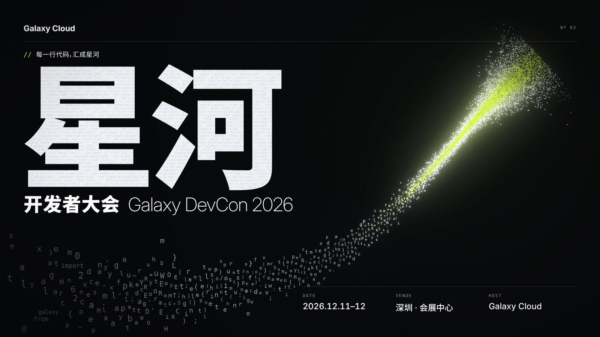

# tech-event-kv

为程序 / 技术类运营活动（开发者大会、技术峰会、黑客松、发布会、AI 大会、技术沙龙）构思并产出 KV 主视觉物料的 agent skill。



## 思路

- **参考调研**：联网检索本活动往届、同类活动和跨界作品，拆解手法，归纳红海清单和天花板，生成情绪板。
- **概念先行**：从活动主张出发，经过三层联想和 10 种造境手法发散 ≥ 9 个概念，按直白度（L0–L3）和五维打分筛选，避免"AI = 神经网络"式的直译。
- **场景式主图**：提示词先写世界再写主体，强制写主体与环境的互动（光的溢出、倒影、环境接触……），交给外部生图模型生成不含文字的主图。
- **排版系统**：6 套排版系统（swiss / lockup / bleed / editorial / terminal / center）+ 字体配方库；渲染时检测字体是否真的加载。
- **分层合成**：主图 → 雾 → 细线 → 巨字 → 前景抠图 → 文字 → 调色 / 暗角 / 颗粒。文字可以从主体后面穿过，颜色从主图取，颗粒同时覆盖图和字。
- **主图路线**：生图模型 / 生成式代码图层 / 混合 / 模型出光影 + 排版出内容 / 透镜后期，按概念选择。
- **审美自检**：硬性检查 + 八维审美评分（先和天花板作品并排校准），不达标按最低分维度回到对应步骤迭代。
- **经验沉淀**：评审经验进 `references/lessons.md`，设计师标注资料进 `library/`。

## 结构

```
SKILL.md                    主流程与硬规则
references/
  brief-analysis.md         需求分析：九个问题、风格翻译、验收清单、待确认问题（第 1 步关卡）
  genres.md                 活动类型与视觉惯例、各类型评分权重
  brief.md                  brief 字段、活动类型 → 默认调性
  research.md               参考调研：范围、来源、检索词、拆解表、红海清单、版权边界
  concept.md                概念推导：主张、三层联想、造境手法、直白度、打分、艺术指导
  directions.md             9 种视觉风格
  prompt-recipes.md         7 段式场景提示词
  integration.md            主体与背景融合：提示词手法 + 合成手段
  typography.md             字体库、字体配方、6 套排版系统、微排版规则
  contemporary.md           时代感（老气信号）、可拥有的视觉装置、大字细节、生成式图层
  sizes.md                  延展尺寸表
  qa-checklist.md           硬性检查 + 审美评分
  case-studies.md           参考案例拆解
  lessons.md                经验库：踩过的坑（症状 → 原因 → 修正 → 规则位置）
templates/
  kv.html                   分层合成 + 排版系统模板
  config.example.json       配置示例
scripts/
  image_model.py            生图模型适配器（接你自己的模型）
  render.py                 多尺寸渲染、主图取色、字体检测、总览图
  cutout.py                 前景抠图（蒙版 / rembg / 亮度键）
  placeholder.py            占位主图
  moodboard.py              参考图情绪板
  glyph_flow.py             生成式图层：真实代码字符组成的流 + 代码纹理
  glass_lens.py             玻璃透镜后期：折射、阴影、焦散，透镜内外两种状态
  compose_photo.py          把生图模型的透明物体照片和排版内容合成（自动检测 + 折射）
  library_index.py          设计资料库索引、查询、对照板
  photo_post.py             摄影感后期：深度景深、泛光、光晕、调色、颗粒
examples/galaxy-devcon/     完整示例：参考调研、概念推导、4 轮评审与修改记录、生成式主图、配置、输出
examples/tju-cann/          校园活动示例：矢量插画代码直出（跑道 × 代码），路线 F
library/                    设计资料库：标注模板、范例条目、自动索引
```

## 快速开始

```bash
pip install playwright pillow && python -m playwright install chromium
python scripts/render.py examples/galaxy-devcon/config.json --out /tmp/kv-out
```

示例主图是 WebGL 渲染的替身图，用于验证模板；实际项目由生图模型生成。

## 接入生图模型

二选一：设置环境变量 `KV_IMAGE_ENDPOINT`（可选 `KV_IMAGE_API_KEY`、`KV_IMAGE_MODEL`）走通用 HTTP 接口；或改写 `scripts/image_model.py` 里的 `generate()`。未配置时 skill 会把提示词交给用户手动生成。

## 字体

模板不附带字体文件。中文商用字体（HarmonyOS Sans、阿里巴巴普惠体、得意黑等）请自行下载、确认授权后放进项目的 `fonts/` 目录，在 config 的 `fonts.files` 里登记。渲染环境能联网时，英文开源字体可以写进 `fonts.google`。

## 版本

- v1.4：概念推导新增"道具与漂浮元素设计"（主道具是什么、谁给谁、展示什么信息、去哪里；漂浮元素按路径 / 两个世界 / 同一家族组织）；经验 L26
- v1.3：运营 / 校园类"宁少勿乱"物件规则、标题字去老气规则；经验 L25；天大示例 v4 第二轮
- v1.2：没有生图模型时的潮玩物件路线（three.js 圆角几何体 + PBR + 前景虚化）；天大示例 v4 成品 KV；经验 L24
- v1.1：运营 / 校园类 3D 潮玩的分区提示词结构（含字版当风格板、无字版出主图）；genres A 硬要求（技术元素长在物件上、黑色定制标题字、合影安全区）；经验 L23；天大示例 v3 风格板与 image-2 提示词
- v1.0：需求分析前置为关卡（brief-analysis.md）；活动类型与视觉惯例（genres.md），评分按类型调权；风格板关卡；运营类标题字设计；需求验收清单作为第一道自检；经验 L19–L22
- v0.9：路线 G（程序化 3D 场景 + 摄影后期）、photo_post.py；硬规则 0（交付位图，不受实现手段限制）；天大示例升级为场景版
- v0.8：主图路线 F（矢量插画代码直出）与天津大学 CANN 校园活动示例；经验 L16–L17
- v0.7：SKILL.md 重写为统一结构（主图路线表、排版系统表、硬规则 7 条）；经验库 lessons.md；设计资料库 library/ 与 library_index.py
- v0.6：invite 排版系统（一图一句）；compose_photo.py（模型出光影、排版出内容）；评分校准与高端品牌减法规则
- v0.5：玻璃透镜后期 glass_lens.py；lockup 增加 info_side / mark_weight / mark_tracking；真实品牌概念稿规则
- v0.4：时代感与识别度规则（contemporary.md）、lockup 排版系统与纹理填充、生成式代码图层 glyph_flow.py、D9 风格；评分增加第 8 项
- v0.3：参考调研步骤与情绪板脚本；按完整流程重做示例，并据此修正取色、巨字定位（mark_baseline）、竖版信息区等问题
- v0.2：概念推导方法、场景式提示词与融合手法、字体库与排版系统、分层合成、审美评分、完整示例
- v0.1：基础流程、单层排版模板
