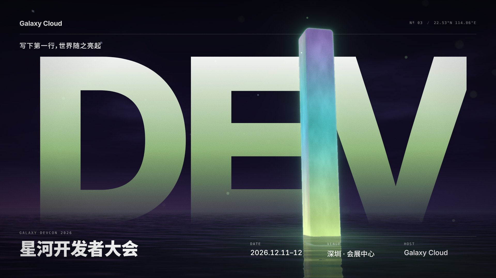

# tech-event-kv

为程序 / 技术类运营活动（开发者大会、技术峰会、黑客松、发布会、AI 大会、技术沙龙）构思并产出 KV 主视觉物料的 agent skill。



## 思路

- **概念先行**：从活动主张出发，经过三层联想和 10 种造境手法发散 ≥ 9 个概念，按直白度（L0–L3）和五维打分筛选，避免"AI = 神经网络"式的直译。
- **场景式主图**：提示词先写世界再写主体，强制写主体与环境的互动（光的溢出、倒影、环境接触……），交给外部生图模型生成不含文字的主图。
- **排版系统**：5 套排版系统（swiss / bleed / editorial / terminal / center）+ 字体配方库；渲染时检测字体是否真的加载。
- **分层合成**：主图 → 雾 → 细线 → 巨字 → 前景抠图 → 文字 → 调色 / 暗角 / 颗粒。文字可以从主体后面穿过，颜色从主图取，颗粒同时覆盖图和字。
- **审美自检**：硬性检查 + 七维审美评分，不达标按最低分维度回到对应步骤迭代。

## 结构

```
SKILL.md                    主流程与硬规则
references/
  brief.md                  brief 字段、活动类型 → 默认调性
  concept.md                概念推导：主张、三层联想、造境手法、直白度、打分、艺术指导
  directions.md             8 种视觉风格
  prompt-recipes.md         7 段式场景提示词
  integration.md            主体与背景融合：提示词手法 + 合成手段
  typography.md             字体库、字体配方、5 套排版系统、微排版规则
  sizes.md                  延展尺寸表
  qa-checklist.md           硬性检查 + 审美评分
  case-studies.md           参考案例拆解
templates/
  kv.html                   分层合成 + 排版系统模板
  config.example.json       配置示例
scripts/
  image_model.py            生图模型适配器（接你自己的模型）
  render.py                 多尺寸渲染、主图取色、字体检测、总览图
  cutout.py                 前景抠图（蒙版 / rembg / 亮度键）
  placeholder.py            占位主图
examples/galaxy-devcon/     完整示例：concept.md、提示词、配置、主图、输出
```

## 快速开始

```bash
pip install playwright pillow && python -m playwright install chromium
python scripts/render.py examples/galaxy-devcon/config.json --out /tmp/kv-out
```

示例主图是 WebGL 渲染的替身图，用于验证模板；实际项目由生图模型生成。

## 接入生图模型

二选一：设置环境变量 `KV_IMAGE_ENDPOINT`（可选 `KV_IMAGE_API_KEY`、`KV_IMAGE_MODEL`）走通用 HTTP 接口；或改写 `scripts/image_model.py` 里的 `generate()`。未配置时 skill 会把提示词交给用户手动生成。

## 字体

模板不附带字体文件。中文商用字体（HarmonyOS Sans、阿里巴巴普惠体、得意黑等）请自行下载、确认授权后放进项目的 `fonts/` 目录，在 config 的 `fonts.files` 里登记。渲染环境能联网时，英文开源字体可以写进 `fonts.google`。

## 版本

- v0.2：概念推导方法、场景式提示词与融合手法、字体库与排版系统、分层合成、审美评分、完整示例
- v0.1：基础流程、单层排版模板
